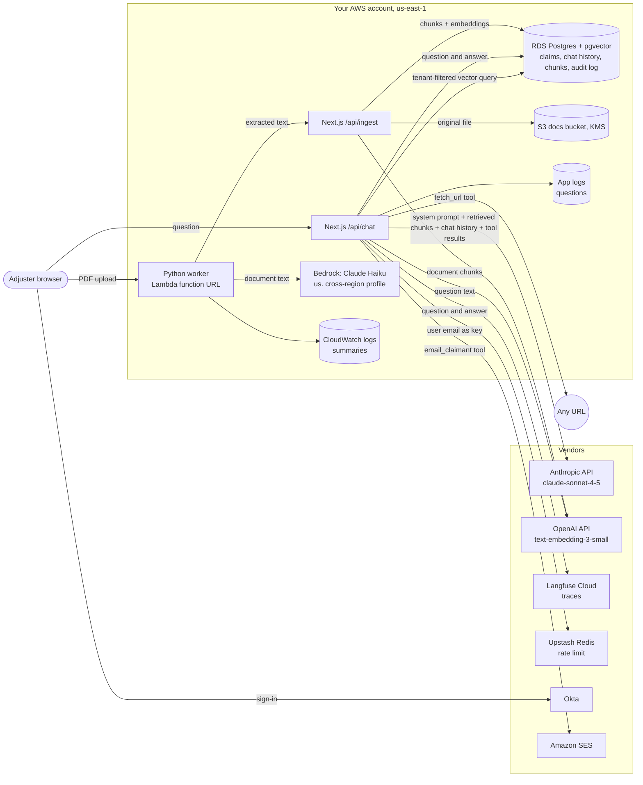

# Security review packet: claims-copilot

> **Draft for review.** Prepared from the code in `test/security-packet-fixture`
> (a test fixture, not a real system) on 2026-11-08 with security-review-packet 0.1.0.
> It describes what the code shows. It is not an attestation and does not
> claim compliance with any framework.

## Legend

- **[Found: file:line]**: seen in the code at that line.
- **[Assumed]**: inferred, not confirmed. Check before relying on it.
- **[Ask team]**: needs an answer from the team before security can sign off.

## 1. System overview

claims-copilot helps insurance claims adjusters answer questions about
policies and claims. Adjusters sign in with Okta and chat with Claude, which
searches a pgvector index of policy documents and can call six tools: look
up a claim, change a claim's status, run SQL, fetch a URL and email a
claimant. A Python worker extracts text from uploaded PDFs, summarizes them
with Claude on Bedrock and sends the text to the app's ingest route. AWS
infrastructure is in Terraform, in `us-east-1`.

- Purpose: answer adjusters' questions over policy documents and claim records [Found: lib/llm.ts:6]
- Users: claims adjusters signing in through the company Okta tenant [Found: auth.ts:4-11]
- App: Next.js 14.2.3 (App Router) with Auth.js v5 beta [Found: package.json:20-21]
- Worker: FastAPI service, deployed as an AWS Lambda function with a public function URL [Found: worker/app.py:15, infra/main.tf:83-96]
- Chat model: Anthropic `claude-sonnet-4-5` via the Anthropic API, overridable with `CHAT_MODEL` [Found: lib/llm.ts:3]
- Summary model: `claude-haiku-4-5` (Anthropic API, defined but unused in the app) and `us.anthropic.claude-haiku-4-5-20251001-v1:0` on Bedrock in the worker [Found: lib/llm.ts:4, worker/app.py:18]
- Embeddings: OpenAI `text-embedding-3-small` [Found: lib/retrieval.ts:5-8]
- Agent tools: 6, of which 4 can change data or reach outside the system (update_claim_status, run_report_query, fetch_url, email_claimant) [Found: lib/agent/tools.ts:29, lib/agent/tools.ts:40, lib/agent/tools.ts:49, lib/agent/tools.ts:58]
- MCP servers for developers: claims-db (Postgres) and github [Found: .mcp.json:3, .mcp.json:8]
- Region: `us-east-1` (default of `var.region`) [Found: infra/variables.tf:1-4, infra/main.tf:14-16]
- Environments covered by this packet: production only? [Ask team]
- Where the Next.js app is hosted (no hosting config in the repo) [Ask team]

## 2. Data flow

- Chat route sends the system prompt, retrieved chunks and the conversation to Anthropic [Found: app/api/chat/route.ts:36-40]
- Question text goes to OpenAI for embedding on every chat turn; document chunks go there on ingest [Found: app/api/chat/route.ts:32, lib/retrieval.ts:14, lib/retrieval.ts:27]
- Questions and answers go to Langfuse [Found: app/api/chat/route.ts:33, app/api/chat/route.ts:45]
- Langfuse host defaults to `cloud.langfuse.com` unless `LANGFUSE_BASEURL` is set [Found: lib/telemetry.ts:7]
- Worker sends full document text (up to 50,000 characters) to Bedrock [Found: worker/app.py:48-51]
- Worker posts extracted text to the ingest route [Found: worker/app.py:37-38]
- Ingest stores the original file in S3 and the chunks in Postgres [Found: app/api/ingest/route.ts:15-16]
- Rate limiting uses Upstash Redis, keyed by user email [Found: app/api/chat/route.ts:12, app/api/chat/route.ts:25]
- Where Upstash Redis is hosted (vendor-managed is assumed from the REST env vars) [Assumed]

## 3. Data inventory and classification

Classifications below are a first guess from the field names. The team
decides the real classification.

| Data | Classification | Where it is stored | Which model or vendor receives it | Retained by vendor? | Used for training? | Evidence |
|---|---|---|---|---|---|---|
| Adjuster questions | Confidential; may contain claimant PII or health details [Assumed] | `chat_messages` table; app logs; Langfuse | Anthropic, OpenAI (embedding), Langfuse | [Ask team] | [Ask team] | [Found: lib/db.ts:12, app/api/chat/route.ts:30, app/api/chat/route.ts:33] |
| Model answers | Confidential [Assumed] | `chat_messages` table; Langfuse | Langfuse | [Ask team] | [Ask team] | [Found: app/api/chat/route.ts:44-45] |
| Claim records: claimant name, diagnosis code, reserve amount | Restricted: PII, and PHI if diagnosis codes are health data [Assumed] | `claims` table (RDS) | Anthropic, when `lookup_claim` returns them as tool results | [Ask team] | [Ask team] | [Found: lib/agent/tools.ts:22] |
| Policy documents and claim files (originals) | Confidential [Assumed] | S3 docs bucket, KMS encrypted | none directly | n/a | n/a | [Found: app/api/ingest/route.ts:15, infra/main.tf:24-36] |
| Document text and chunks | Confidential to Restricted, depending on the document [Assumed] | `policy_chunks` table | OpenAI (embedding), Bedrock (summary), Anthropic (retrieved context) | [Ask team] | [Ask team] | [Found: lib/retrieval.ts:26-31, worker/app.py:48-51] |
| Embeddings | Confidential: can leak the text they were made from [Assumed] | `policy_chunks.embedding` | OpenAI creates them | [Ask team] | [Ask team] | [Found: lib/retrieval.ts:29] |
| Document summaries | Confidential to Restricted [Assumed] | Worker logs (CloudWatch, 30 days) | Bedrock creates them | [Ask team] | n/a | [Found: worker/app.py:36, infra/main.tf:78-81] |
| Adjuster email and tenant ID | Internal PII [Assumed] | JWT session; audit log; Upstash keys; Langfuse user ID | Upstash, Langfuse, Okta | [Ask team] | n/a | [Found: auth.ts:13-20, lib/db.ts:19, app/api/chat/route.ts:25, app/api/chat/route.ts:33] |
| Emails to claimants | Restricted [Assumed] | Audit log stores recipient and subject only | Amazon SES | [Ask team] | n/a | [Found: lib/agent/tools.ts:62-67] |
| Feedback ratings and comments | Internal [Assumed] | `feedback` table | none | n/a | n/a | [Found: app/actions/feedback.ts:6] |
| Analytics exports | Unknown: no code writes to the exports bucket [Assumed] | S3 exports bucket | [Ask team] | n/a | n/a | [Found: infra/main.tf:46-49] |

- Is PHI in scope (diagnosis codes, medical records in claim files)? If yes, HIPAA applies and every vendor in the flow needs a BAA. [Ask team]
- How long are `chat_messages` and `audit_log` rows kept? No retention or deletion job was found in this repo. [Ask team]
- The Bedrock model ID starts with `us.`, a cross-region inference profile: requests can be served from other US regions. Is that acceptable for data residency? [Found: worker/app.py:18]

### Vendor terms to confirm

- [ ] Anthropic API: retention of inputs and outputs, zero data retention status, no training under our commercial terms [Ask team]
- [ ] OpenAI API: retention, zero data retention eligibility, no training on API data under our agreement [Ask team]
- [ ] AWS Bedrock: covered by our AWS agreement and BAA (if PHI); cross-region profile acceptable [Ask team]
- [ ] Langfuse Cloud: region, retention of traces, DPA; or self-host [Ask team]
- [ ] Upstash: region and DPA (receives adjuster emails as rate-limit keys) [Ask team]
- [ ] Okta and Amazon SES: covered by existing agreements [Ask team]
- [ ] Every vendor above: listed on our sub-processor list [Ask team]

## 4. Access control and identity

| Entry point | Who can call it | Auth check | Evidence |
|---|---|---|---|
| `POST /api/chat` | Signed-in adjusters with a tenant ID | Session check, tenant check, then rate limit; also matched by middleware | [Found: app/api/chat/route.ts:20-26, middleware.ts:5] |
| `POST /api/ingest` | Anyone who can reach the app | **None found.** Takes `tenantId` from the request body, so a caller can write to any tenant's index (F-002) | [Found: app/api/ingest/route.ts:13-16] |
| `POST /api/admin/reindex` | Anyone with `REINDEX_API_KEY` | Shared key in `x-api-key`, compared with `!==` (not constant-time) | [Found: app/api/admin/reindex/route.ts:4] |
| `GET /api/health` | Anyone | None; returns `{ ok: true }` only (F-017) | [Found: app/api/health/route.ts:1-3] |
| Server action `submitFeedback` | Anyone who can reach the app | **None found** (F-007) | [Found: app/actions/feedback.ts:5-6] |
| Worker `POST /documents` | Callers with `WORKER_API_KEY` | `Depends(verify_api_key)`, compared with `!=` | [Found: worker/app.py:21-23, worker/app.py:32] |
| Worker `POST /summarize` | Anyone who can reach the worker | **None found**; sends caller text to Bedrock (F-006) | [Found: worker/app.py:42-44] |
| Worker `GET /healthz` | Anyone | None (F-018) | [Found: worker/app.py:26-28] |
| Worker Lambda function URL | Anyone on the internet | `authorization_type = "NONE"`: only the app-level key above protects `/documents` (F-004) | [Found: infra/main.tf:93-96] |

- Identity provider: Okta via Auth.js; JWT sessions, 8 hour lifetime [Found: auth.ts:5-13]
- Tenant ID comes from the Okta profile at sign-in and is read from the session, not the request, on the chat route [Found: auth.ts:16, app/api/chat/route.ts:22]
- Middleware protects only `/dashboard` and `/api/chat`; every other route must check auth itself [Found: middleware.ts:5]
- Next.js 14.2.3 and next-auth 5.0.0-beta.25 have critical advisories in npm audit, including Auth.js auth checks that can fail open; routes that rely only on middleware are most exposed (F-005) [Found: package.json:20-21]
- Service-to-service: the worker calls `/api/ingest` with a bearer token that is hard-coded in source, and `/api/ingest` doesn't check it (F-001, F-002) [Found: worker/settings.py:8, worker/app.py:38]
- Secrets: read from environment variables; no secrets manager client in the app code. Terraform creates a Secrets Manager secret but nothing in the repo reads it. [Found: infra/main.tf:115-118]
- Who can set production env vars and read the Secrets Manager secret, and how keys are rotated [Ask team]
- Database: TLS required with certificate verification [Found: lib/db.ts:5]
- Database role: the app uses one `DATABASE_URL` for all tools, so `run_report_query` runs with the same rights as `update_claim_status` [Found: lib/db.ts:3-4, lib/agent/tools.ts:44]
- Is that role read-write on every table? [Ask team]
- Worker IAM policy allows `bedrock:InvokeModel` and `bedrock:InvokeModelWithResponseStream` on all resources (`"*"`), so any Bedrock model in the account (F-012) [Found: infra/main.tf:103-113]
- RDS: not public, deletion protection on, ingress only from `10.0.0.0/16` [Found: infra/main.tf:60-62, infra/main.tf:68-76]

## 5. Logging, monitoring and audit trail

- The chat route logs every adjuster question with the adjuster's email to stdout (F-011) [Found: app/api/chat/route.ts:30]
- The worker logs every document summary (F-011) [Found: worker/app.py:36]
- Worker logs go to CloudWatch with 30-day retention and the service-managed key (F-015) [Found: infra/main.tf:78-81]
- Where the Next.js app's stdout goes, and how long it is kept [Ask team]
- Every question and answer is traced to Langfuse, with the adjuster email as user ID (F-019) [Found: app/api/chat/route.ts:33, app/api/chat/route.ts:45]
- Full conversation history is stored per tenant in `chat_messages` [Found: lib/db.ts:10-15]
- Audit log: `update_claim_status` and `email_claimant` write who, what and when to `audit_log` [Found: lib/db.ts:17-22, lib/agent/tools.ts:35, lib/agent/tools.ts:67]
- No audit entry for `run_report_query`, `fetch_url` or `lookup_claim`, so ad-hoc SQL and URL fetches leave no record beyond Langfuse [Found: lib/agent/tools.ts:40-56]
- Bedrock model invocation logging is not configured (F-020) [Found: infra/main.tf:1-118]
- Error monitoring, alerting and spend alerts: none found in this repo [Ask team]
- Who can read Langfuse, CloudWatch and the `audit_log` table [Ask team]

## 6. Prompt injection and tool misuse

| Threat | Where it applies | Mitigations found | Gap | Flag |
|---|---|---|---|---|
| T2 Indirect injection from retrieved documents | Policy chunks go into the system prompt | Chunks wrapped in `<documents>` and marked untrusted in the system prompt [Found: lib/llm.ts:6-12] | Prompt wording only; documents can be added by anyone through `/api/ingest` [Found: app/api/ingest/route.ts:13] | F-002 |
| T2 Indirect injection from fetched pages | `fetch_url` returns up to 20,000 characters of any page to the model | none found [Found: lib/agent/tools.ts:52-54] | Fetched text isn't marked untrusted; a page can steer the next tool call [Assumed] | F-008 |
| T3 Exfiltration through tools | `fetch_url` can put claim data in a URL; `email_claimant` can send it to any address | Recipient must be a valid email format [Found: lib/agent/tools.ts:60] | No host allowlist, no recipient allowlist, no approval step [Found: lib/agent/tools.ts:49-69] | F-008, F-009 |
| T5 Excessive agency: arbitrary SQL | `run_report_query` runs model-written SQL | Described as read-only, but nothing enforces it [Found: lib/agent/tools.ts:41-44] | Any statement the DB role allows, across all tenants; no tenant filter, no approval (F-003) [Found: lib/agent/tools.ts:44] | F-003 |
| T5 Excessive agency: claim status changes | `update_claim_status` | `needsApproval: true`, tenant filter in the query, audit entry [Found: lib/agent/tools.ts:32-35] | Confirm the UI shows the change and the approval can't be skipped by the client [Ask team] | |
| T6 SSRF | `fetch_url` runs on the app server | URL must parse [Found: lib/agent/tools.ts:51] | Can reach internal addresses and cloud metadata [Assumed] | F-008 |
| T7 Cross-tenant retrieval | Vector search | Tenant filter on every search, tenant from the session [Found: lib/retrieval.ts:18, app/api/chat/route.ts:22] | Ingest takes the tenant from the request body [Found: app/api/ingest/route.ts:14] | F-002 |
| T8 Sensitive data in logs and traces | Questions, answers, summaries | none found | Prompts in stdout, CloudWatch and Langfuse with no redaction [Found: app/api/chat/route.ts:30, worker/app.py:36, app/api/chat/route.ts:33] | F-011, F-019 |
| T10 Improper output handling | Model output becomes SQL | none found | Same as T5 [Found: lib/agent/tools.ts:44] | F-003 |
| T11 Unbounded consumption | Chat route | Rate limit 20 per minute per user, max 50 messages of 8,000 characters, 5 steps, 2,000 output tokens [Found: app/api/chat/route.ts:12-16, app/api/chat/route.ts:41-42] | Worker `/summarize` has no auth or rate limit and sends up to 50,000 characters to Bedrock [Found: worker/app.py:42-50] | F-006 |
| T12 Supply chain | npm packages and MCP servers | Lockfile present [Found: package-lock.json:1] | Critical advisories in next and next-auth; `claims-db` MCP server runs the latest package at start-up [Found: .mcp.json:4-5] | F-005, F-010 |
| T13 Poisoned index | Ingest | none found | Unauthenticated writes to any tenant's index [Found: app/api/ingest/route.ts:13-16] | F-002 |
| T15 MCP server trust | Developer MCP servers | claims-db connects as a `readonly` user [Found: .mcp.json:5] | Confirm that role is read-only and which data it can see; who holds `GITHUB_PAT` [Ask team] | F-010 |

### Agent tools

| Tool | What it can do | Data it touches | Approval step | Evidence |
|---|---|---|---|---|
| search_policies | Vector search | `policy_chunks`, own tenant | n/a (read-only) | [Found: lib/agent/tools.ts:11-15, lib/retrieval.ts:13-24] |
| lookup_claim | Read one claim | `claims`, own tenant, includes claimant name and diagnosis code | none (read-only) | [Found: lib/agent/tools.ts:17-27] |
| update_claim_status | Change claim status | `claims`, own tenant | `needsApproval: true` | [Found: lib/agent/tools.ts:29-38] |
| run_report_query | Run any SQL | Every table the DB role can reach, every tenant | **none** | [Found: lib/agent/tools.ts:40-47] |
| fetch_url | GET any URL | Internet and internal network | **none** | [Found: lib/agent/tools.ts:49-56] |
| email_claimant | Send email via SES | Any recipient | **none**; the description asks the model to confirm wording, which is not an approval step | [Found: lib/agent/tools.ts:58-70] |

## 7. Human-in-the-loop points

- `update_claim_status` needs the adjuster's approval before it runs [Found: lib/agent/tools.ts:32]
- `email_claimant` has no approval step; only the tool description tells the model to confirm (F-009) [Found: lib/agent/tools.ts:59]
- `run_report_query` and `fetch_url` run without a person seeing the call (F-003, F-008) [Found: lib/agent/tools.ts:40-56]
- Document ingestion: nobody reviews a document before it enters the index [Found: app/api/ingest/route.ts:13-17]
- Answers are shown to the adjuster, who decides what to do with them; the model does not approve or deny claims on its own except through `update_claim_status` [Found: lib/agent/tools.ts:31-32]
- Does the UI show sources for each answer and a note that answers can be wrong? (No UI code in the repo.) [Ask team]

## 8. Vendors and sub-processors

| Vendor | Role | Data sent | Region | DPA / BAA | Evidence |
|---|---|---|---|---|---|
| Anthropic | Chat model | Questions, chat history, retrieved chunks, tool results (incl. claim records) | [Ask team] | [Ask team] | [Found: lib/llm.ts:1-3, app/api/chat/route.ts:36-40] |
| OpenAI | Embeddings | Questions and document chunks | [Ask team] | [Ask team] | [Found: lib/retrieval.ts:2-8] |
| AWS (Bedrock, S3, RDS, Lambda, CloudWatch, SES, KMS) | Model, storage, compute, email | Documents, summaries, all stored data, claimant emails | us-east-1; Bedrock `us.` profile spans US regions [Found: infra/variables.tf:3, worker/app.py:18] | [Ask team] | [Found: infra/main.tf:14-118, worker/app.py:16, lib/agent/tools.ts:7] |
| Langfuse | LLM tracing | Questions, answers, adjuster email | [Ask team] | [Ask team] | [Found: lib/telemetry.ts:1-8] |
| Upstash | Rate-limit store | Adjuster email (as key), request counts | [Ask team] | [Ask team] | [Found: app/api/chat/route.ts:2-3, app/api/chat/route.ts:12] |
| Okta | Identity provider | Adjuster identity, tenant claim | [Ask team] | [Ask team] | [Found: auth.ts:2, auth.ts:7-11] |
| GitHub (MCP, developers only) | Code hosting | Whatever developers' agents send | n/a | [Ask team] | [Found: .mcp.json:8-12] |
| Hosting for the Next.js app | Runtime | Everything the app handles | [Ask team] | [Ask team] | [Ask team] |

## 9. Incident response contacts

| Role | Name | Contact | Notes |
|---|---|---|---|
| Incident lead | {{name}} | {{email / phone}} | [Ask team] |
| Security contact | {{name}} | {{email}} | [Ask team] |
| Engineering on-call | {{rotation}} | {{pager}} | [Ask team] |
| Privacy / DPO | {{name}} | {{email}} | [Ask team] |
| Vendor security contacts | Anthropic, OpenAI, AWS, Langfuse, Upstash, Okta | {{trust portals}} | [Ask team] |

- Kill switch: no feature flag or setting to turn off the assistant or a single tool was found; tools are always registered [Found: app/api/chat/route.ts:40, lib/agent/tools.ts:9-71]
- How to rotate each key (`ANTHROPIC_API_KEY`, `OPENAI_API_KEY`, `LANGFUSE_SECRET_KEY`, `REINDEX_API_KEY`, `WORKER_API_KEY`, the hard-coded worker token) [Ask team]

## 10. Open questions

1. The worker has a hard-coded service token in source. Has it been rotated, and can it move to Secrets Manager? (F-001) [Ask team]
2. Should `/api/ingest` require the worker's token (or IAM auth), and take the tenant from a trusted source instead of the request body? (F-002) [Ask team]
3. Can `run_report_query` be removed or replaced with fixed, tenant-filtered reports on a read-only role? If it stays, who approves each query? (F-003) [Ask team]
4. Should the worker's Lambda function URL use `AWS_IAM` auth instead of `NONE`, and should `/summarize` require the API key? (F-004, F-006) [Ask team]
5. When will Next.js and next-auth be upgraded past the critical advisories? (F-005) [Ask team]
6. Is PHI in scope? If yes, which vendors have a signed BAA? [Ask team]
7. What do Anthropic, OpenAI, Langfuse and Upstash retain, for how long, and is any of it used for training under our agreements? [Ask team]
8. Should `fetch_url` have a host allowlist and block internal addresses, or be removed? (F-008) [Ask team]
9. Should `email_claimant` require approval in the UI, like `update_claim_status`? (F-009) [Ask team]
10. Can questions and summaries be dropped from logs, or redacted before logging and tracing? (F-011) [Ask team]
11. How long are chat history and the audit log kept, and who can read them? [Ask team]
12. Should the Bedrock IAM policy be limited to the one model the worker uses? (F-012) [Ask team]
13. Should `submitFeedback` check the session? (F-007) [Ask team]
14. Should the claims-db MCP server be pinned to a version? (F-010) [Ask team]
15. Is the `us.` Bedrock cross-region profile acceptable for data residency? [Ask team]
16. Who are the incident contacts, and how is the assistant turned off in an incident? [Ask team]

## Appendix A. Framework coverage

> This table maps what the packet found to the areas questionnaires ask
> about. It is a coverage map for preparing answers, not a statement of
> compliance.

| Framework | Area | Status | Evidence or gap |
|---|---|---|---|
| SOC 2 CC6.1 | Authentication on entry points | Partial | Chat route checks the session [Found: app/api/chat/route.ts:20-23]; ingest, summarize and feedback have no check (F-002, F-006, F-007) |
| SOC 2 CC6.1 | Encryption at rest | Partial | RDS, docs bucket and secret use KMS [Found: infra/main.tf:58-59, infra/main.tf:28-36, infra/main.tf:117]; exports bucket and log group use defaults (F-013, F-015) |
| SOC 2 CC6.6 | Boundary protection | Gap | Public Lambda function URL with no auth (F-004) [Found: infra/main.tf:95] |
| SOC 2 CC6.7 | Data to third parties | Partial | Flows documented in section 2; vendor terms unconfirmed [Ask team] |
| SOC 2 CC7.1 | Vulnerability management | Gap | Critical npm advisories (F-005); pip-audit not run [Found: worker/requirements.txt:1] |
| SOC 2 CC7.2 | Monitoring | Partial | Audit log for two tools [Found: lib/db.ts:17-22]; no alerting found [Ask team] |
| SOC 2 CC8.1 | Change management | Not assessed | CI and review settings are outside the repo [Ask team] |
| SOC 2 CC9.2 | Vendor risk | Partial | Vendor list in section 8; DPAs unconfirmed [Ask team] |
| NIST AI RMF GOVERN 6 | Third-party AI risk | Partial | Models and vendors listed [Found: lib/llm.ts:3-4, lib/retrieval.ts:5]; terms unconfirmed [Ask team] |
| NIST AI RMF MEASURE 2.7 | Security and resilience | Partial | Threat review in section 6; no evals or red-team tests in the repo [Assumed] |
| NIST AI RMF MANAGE 2.4 | Ability to deactivate | Gap | No kill switch found [Found: app/api/chat/route.ts:40] |
| ISO/IEC 42001 A.7 | Data for AI systems | Partial | Ingestion path documented; no provenance or review step [Found: app/api/ingest/route.ts:13-17] |
| ISO/IEC 42001 A.9 | Human oversight | Partial | Approval on claim status changes only [Found: lib/agent/tools.ts:32] |
| OWASP LLM01 | Prompt injection | Partial | Untrusted-content marking [Found: lib/llm.ts:7]; open ingest and fetch (F-002, F-008) |
| OWASP LLM02 | Sensitive information disclosure | Gap | Prompts in logs and traces (F-011, F-019) [Found: app/api/chat/route.ts:30] |
| OWASP LLM03 | Supply chain | Gap | F-005, F-010 [Found: .mcp.json:4-5] |
| OWASP LLM06 | Excessive agency | Gap | Arbitrary SQL, open fetch, email without approval (F-003, F-008, F-009) [Found: lib/agent/tools.ts:44] |
| OWASP LLM08 | Vector and embedding weaknesses | Partial | Tenant-filtered search [Found: lib/retrieval.ts:18]; tenant from request on ingest (F-002) |
| OWASP LLM10 | Unbounded consumption | Partial | Rate and step limits on chat [Found: app/api/chat/route.ts:12, app/api/chat/route.ts:41-42]; none on `/summarize` (F-006) |
| HIPAA §164.312(b) | Audit controls | Partial, if PHI is in scope | Audit log for two of six tools [Found: lib/agent/tools.ts:35, lib/agent/tools.ts:67] |
| HIPAA §164.308(b) | Business associate agreements | Not assessed | [Ask team] |

## Appendix B. Scan details

- Inventory: `inventory.json` and `inventory.md` next to this file (security-review-packet 0.1.0, 2026-11-08)
- Dependency audit: npm audit ran on `package-lock.json`; pip-audit was not installed, so the worker's Python dependencies were not checked
- Not covered: hosting settings for the Next.js app, the UI, cloud console settings outside Terraform, vendor contracts, and whether the controls found work at run time
