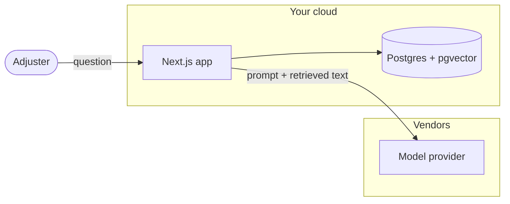

# Security review packet: {{system name}}

<!--
Fill every section from inventory.json and from reading the cited files.
Delete these comments when done.

Rules for every bullet and every table row (check-packet.mjs enforces them):
  [Found: path/to/file.ts:42]       you opened the file and the line shows it
  [Found: a.ts:10, infra/main.tf:31-40]   several citations are fine
  [Assumed]                          a reasonable inference you did not see in code
  [Ask team]                         only the team can answer (contracts, cloud
                                     console settings, people, process)
A row can carry more than one tag, e.g. "Encrypted at rest [Found: infra/main.tf:60];
key rotation policy [Ask team]".

Never write a control that isn't in the code or confirmed by the team. If you
didn't find it, say "none found in this repo" and tag it [Ask team].
Cite inventory flag IDs (F-001…) where you cover them; every critical and
high flag must appear somewhere.
Paths are relative to the repo root that was scanned.
-->

> **Draft for review.** Prepared from the code in `{{repo}}` at commit `{{commit}}` on {{date}}.
> It describes what the code shows. It is not an attestation and does not
> claim compliance with any framework.

## Legend

- **[Found: file:line]**: seen in the code at that line.
- **[Assumed]**: inferred, not confirmed. Check before relying on it.
- **[Ask team]**: needs an answer from the team before security can sign off.

## 1. System overview

<!-- Two to four sentences of plain prose first: what the system does, who
uses it, where it runs. Then the facts as bullets. -->

- Purpose: … [Assumed]
- Users and how they reach it: … [Found: …]
- Runtime and hosting: … [Found: …]
- Model providers and models: … [Found: …]
- Agent tools: N tools, of which N can change data or reach the internet [Found: …]
- Environments covered by this packet: … [Ask team]

## 2. Data flow

<!-- Mermaid flowchart. One node per component in the inventory: user,
app, each route group, each model provider, each data store, each vendor
that receives data, each MCP server. Label edges with the data that moves
("question + retrieved chunks", "embeddings", "traces with prompts").
Mark trust boundaries with subgraphs (your cloud / vendor). Every vendor node
must also appear in section 8. -->

- Every arrow above is backed by: … [Found: …]

## 3. Data inventory and classification

<!-- One row per kind of data. Classification: Public / Internal /
Confidential / Restricted (PII, PHI, financial, credentials). Use the
dataTerms hints in the inventory, but classification is the team's call:
tag it [Assumed] unless the team has told you. "Retained by vendor" and
"Used for training" come from contracts, so they are [Ask team] unless
the team has confirmed them. -->

| Data | Classification | Where it is stored | Which model or vendor receives it | Retained by vendor? | Used for training? | Evidence |
|---|---|---|---|---|---|---|
| User questions | Confidential [Assumed] | … | … | [Ask team] | [Ask team] | [Found: …] |

### Vendor terms to confirm

<!-- One checkbox per vendor that receives data. Use references/vendor-terms.md. -->

- [ ] {{vendor}}: retention period for API inputs and outputs [Ask team]
- [ ] {{vendor}}: inputs not used for training under our agreement [Ask team]
- [ ] {{vendor}}: DPA signed; BAA signed if PHI is in scope [Ask team]
- [ ] {{vendor}}: region where data is processed and stored [Ask team]

## 4. Access control and identity

<!-- Who can call what. One row per route, server action and public
function URL from the inventory. Include service-to-service auth
(API keys, signed requests) and the identity provider. -->

| Entry point | Who can call it | Auth check | Evidence |
|---|---|---|---|
| `POST /api/chat` | Signed-in users | Session check | [Found: …] |

- Identity provider and session lifetime: … [Found: …]
- Tenant isolation: … [Found: …]
- Secrets: where they live, who can read them, rotation [Found: …] [Ask team]
- Least privilege for the app's cloud role: … [Found: …]

## 5. Logging, monitoring and audit trail

- What is logged, and whether it includes prompts or outputs: … [Found: …]
- Where logs go and how long they are kept: … [Found: …]
- Who can read logs: … [Ask team]
- Audit trail of agent actions (who, what, when): … [Found: …]
- Alerting on abuse, errors and spend: … [Ask team]
- LLM tracing vendor and what it receives: … [Found: …]

## 6. Prompt injection and tool misuse

<!-- Use references/threats.md. One row per threat that applies to this
system. "Mitigations found" lists only what the code shows, with citations.
"Gap" says what's missing. Never list a mitigation you did not see. -->

| Threat | Where it applies | Mitigations found | Gap | Flag |
|---|---|---|---|---|
| Indirect prompt injection from retrieved documents | … | … [Found: …] | … [Assumed] | F-… |

### Agent tools

| Tool | What it can do | Data it touches | Approval step | Evidence |
|---|---|---|---|---|
| … | … | … | … | [Found: …] |

## 7. Human-in-the-loop points

<!-- Where a person must approve before the system acts, and where the
model's output is shown to a person before it is used. Include tools with
no approval step as a gap. -->

- … [Found: …]

## 8. Vendors and sub-processors

| Vendor | Role | Data sent | Region | DPA / BAA | Evidence |
|---|---|---|---|---|---|
| … | Model provider | … | [Ask team] | [Ask team] | [Found: …] |

## 9. Incident response contacts

<!-- Placeholders only. Never invent names, emails or phone numbers. -->

| Role | Name | Contact | Notes |
|---|---|---|---|
| Incident lead | {{name}} | {{email / phone}} | [Ask team] |
| Security contact | {{name}} | {{email}} | [Ask team] |
| Engineering on-call | {{rotation}} | {{pager}} | [Ask team] |
| Privacy / DPO | {{name}} | {{email}} | [Ask team] |
| Vendor security contacts | {{per vendor}} | {{trust portal}} | [Ask team] |

- How to disable the AI feature or a single tool quickly (kill switch): … [Found: …] or [Ask team]
- How to rotate each model provider key: … [Ask team]

## 10. Open questions

<!-- Everything tagged [Ask team] above, grouped, most important first,
each with the flag ID if there is one. Phrase each as a question the team
can answer in one line. -->

1. … (F-…) [Ask team]

## Appendix A. Framework coverage (optional)

<!-- Only if the user asked for it. Use references/framework-map.md.
Status: Evidence in code / Partial / Gap / Not assessed. -->

> This table maps what the packet found to the areas questionnaires ask
> about. It is a coverage map for preparing answers, not a statement of
> compliance.

| Framework | Area | Status | Evidence or gap |
|---|---|---|---|
| OWASP LLM01 | Prompt injection | Partial | … [Found: …] |

## Appendix B. Scan details

<!-- Not checked for tags. -->

- Inventory: `inventory.json` and `inventory.md` next to this file (security-review-packet {{version}}, {{date}})
- Dependency audit: {{ran / skipped and why}}
- Not covered by the scan: copy the "Not covered" list from inventory.md, plus anything else you could not see
